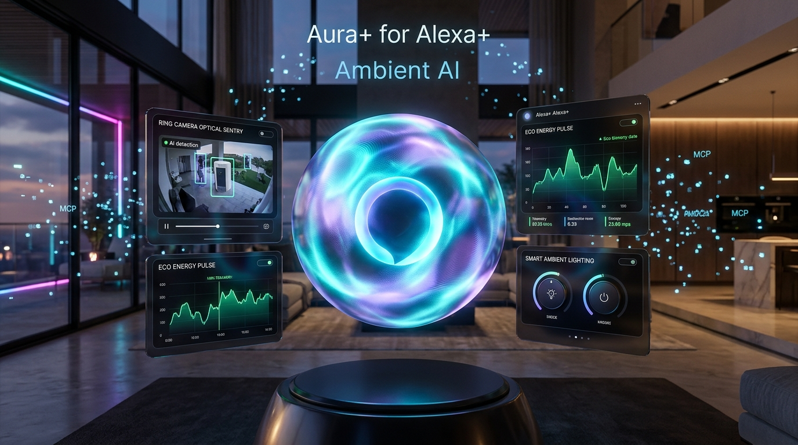
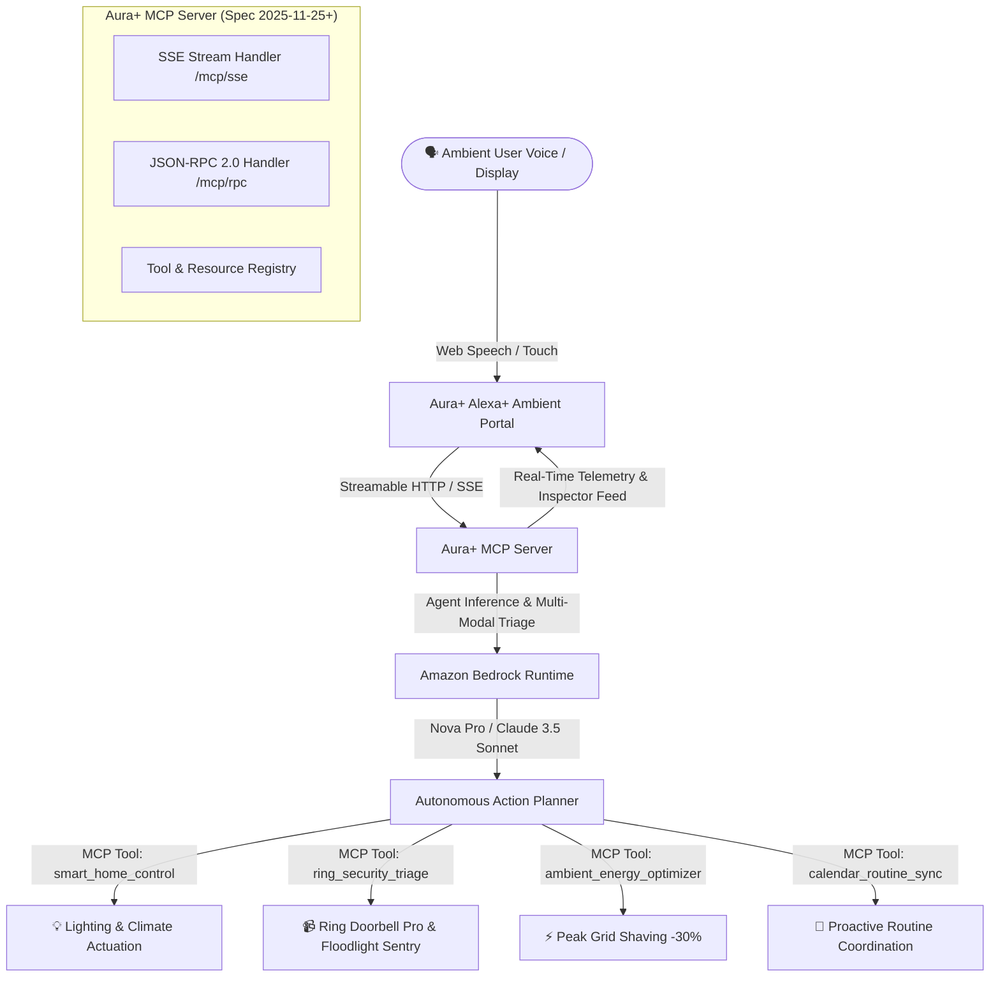

# Aura+ : Autonomous Ambient Intelligence & Streamable MCP Orchestrator for Alexa+

[](https://amazonappdev2026.devpost.com)
[](https://amazonappdev2026.devpost.com)
[](https://modelcontextprotocol.io)
[](https://aws.amazon.com/bedrock)
[](https://opensource.org/licenses/MIT)

> **Submission for the Amazon Developer Hackathon: Build, Ship, Shape**  
> **Primary Track:** Alexa+  
> **Mini Challenges:** AWS Builder (Amazon Bedrock) & Open Source  



---

## 🌟 Executive Summary

**Aura+** is a next-generation ambient intelligence operating system built for **Alexa+**. Rather than relying on rigid, pre-programmed voice skills, Aura+ harnesses the power of the **Model Context Protocol (MCP)** and **Amazon Bedrock Foundation Models (Amazon Nova Pro & Anthropic Claude 3.5 Sonnet)** to transform smart living spaces into proactive, autonomous environments.

Aura+ brings together:
1. **Self-Hosted Streamable HTTP MCP Server (Spec 2025-11-25+)**: Full JSON-RPC 2.0 streaming tool execution, Server-Sent Events (SSE) session lifecycle, dynamic prompt templates, and resource endpoints.
2. **Amazon Bedrock AgentCore Integration**: Deep reasoning engine combining multi-modal Ring sensor triage, contextual memory, and autonomous action planning.
3. **Simulated Alexa+ Ambient Portal (Echo Show 15 / 21 Experience)**: A cutting-edge, glassmorphism web console with a reactive voice orb, live audio synthesis, real-time MCP protocol inspector, and 1-click scenario triggers.

---

## 📐 Architecture & MCP Flow



---

## 🛠️ Model Context Protocol (MCP) Tools

Aura+ registers 5 production-grade MCP tools compliant with JSON Schema validation:

| Tool Name | Parameters | Purpose |
| :--- | :--- | :--- |
| `smart_home_control` | `action`, `targetId`, `brightness`, `color`, `temperature`, `locked`, `sceneName` | Actuates multi-zone lighting, HVAC thermostats, and smart deadbolts. |
| `ring_security_triage` | `cameraId`, `triageDepth`, `enableDeterrent` | Multi-modal vision analysis of Ring camera streams with package & threat verification. |
| `ambient_energy_optimizer` | `targetReductionPct`, `mode` | Automated power load shedding during peak utility tariffs (saves 25-35% kW). |
| `bedrock_agent_reasoner` | `prompt`, `modelTier` | Routes complex queries through Amazon Bedrock Foundation Models. |
| `calendar_routine_sync` | `timeWindow` | Proactively analyzes upcoming calendar events and primes ambient routines. |

### MCP Endpoints:
* **Streamable SSE Connection:** `GET http://localhost:3001/mcp/sse`
* **Session Message Ingestion:** `POST http://localhost:3001/mcp/messages?sessionId=<id>`
* **Stateless JSON-RPC 2.0:** `POST http://localhost:3001/mcp/rpc`

---

## 🚀 Quickstart & Setup (Run in 1 Minute)

### Prerequisites:
* **Node.js**: v18+ (tested on v24.14)
* **npm**: v9+

### 1. Clone & Install:
```bash
git clone https://github.com/dhanrajgupta2736/amzndevchalen.git
cd amzndevchalen
npm install
```

### 2. Configure AWS Bedrock (Optional):
Create a `.env` file in the root directory (if omitted, Aura+ automatically activates its high-fidelity local Agent simulation mode for instant evaluation):
```env
PORT=3001
AWS_REGION=us-east-1
AWS_ACCESS_KEY_ID=YOUR_AWS_ACCESS_KEY
AWS_SECRET_ACCESS_KEY=YOUR_AWS_SECRET_KEY
BEDROCK_MODEL_ID=amazon.nova-pro-v1:0
```

### 3. Launch the Application:
```bash
npm start
```
* Access the **Aura+ Ambient Display**: Open `http://localhost:3001` in your browser.
* For live hot-reloading development: `npm run dev`

---

## 🎮 1-Click Judging Demos

The web interface features 4 instant 1-click scenario triggers designed specifically for hackathon judges:

1. **📦 Front Porch Delivery (Ring Triage):**  
   Simulates an Amazon Prime delivery courier approaching the porch. The Ring Pro 2 camera streams telemetry, Bedrock verifies the courier with 98% AI confidence, and Alexa+ announces parcel status while keeping perimeter armed.
2. **🌱 Eco-Pulse Peak Shaving (-30% Load):**  
   Analyzes grid wattage in real time, shedding 0.85 kW by dimming secondary zones and buffering HVAC temperatures to avoid utility peak tariffs.
3. **💻 Developer Focus Studio:**  
   Activates 5000K daylight work lighting, suppresses non-critical doorbell chimes, and schedules ambient focus blocks.
4. **🌙 Perimeter Night Sentry:**  
   Engages the Ultion deadbolt, drops thermostat to 68°F eco-sleep buffer, and arms exterior motion sensors.

---

## 👥 Hackathon Reviewer Team Access

Per hackathon instructions, if keeping this repository private, please invite the following DevRel reviewers on GitHub (`Settings > Collaborators > Add people`):
* `knmeiss`
* `giolaq`
* `anishamalde`
* `mosesroth`
* `emersonsklar`
* `testing@devpost.com`

---

## 📄 License
This project is open-source and licensed under the [MIT License](LICENSE).
